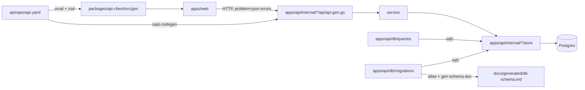
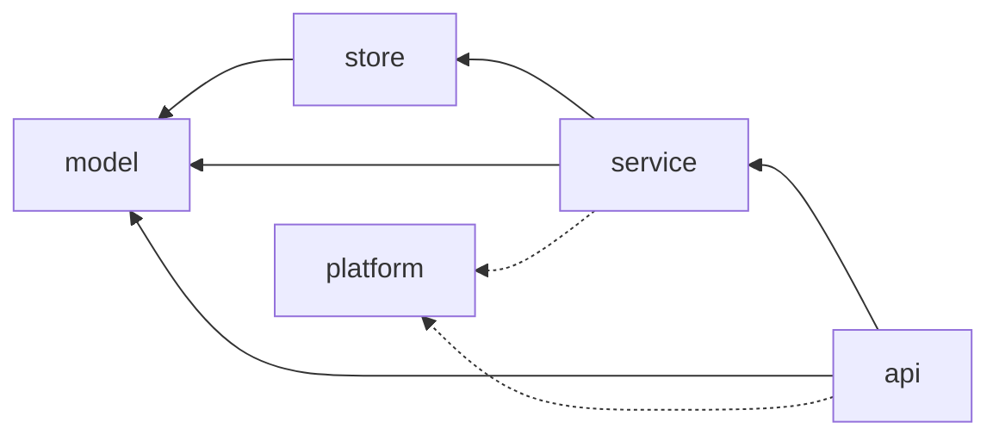

# Architecture

This file is a map, not a manual: where things live, how they connect and which invariants hold. It names
files and symbols so you can find them with grep; it does not link to line numbers, which rot. Rules and
their sensors are in [docs/harness/rules.md](docs/harness/rules.md); decisions in [docs/adr/](docs/adr/README.md).

## Bird's eye view

One contract, two sides. `api/openapi.yaml` is the single source of truth for the HTTP API. `make gen`
turns it into a strict Go server per tag (oapi-codegen) and a typed TanStack Query + zod client (orval).
SQL queries in `apps/api/db/queries/` become Go store code (sqlc) checked against the migrations.

## Codemap

| Path | What it is |
|------|------------|
| `api/openapi.yaml` | OpenAPI 3.1 contract. One tag per domain plus `platform`. Generator markers `harness:domain-*`. |
| `apps/api/cmd/api` | Entry point. `main.go` creates the only root context and wires platform providers; `routes.go` registers every tag's handlers (marker `harness:domain-routes`). |
| `apps/api/internal/platform` | Shared plumbing, imports no domain: `config` (env, fail fast), `logging` (slog JSON), `db` (pgx pool, `db.Pool`), `auth` (fail-closed stub), `telemetry` (OTel), `problem` (RFC 9457 errors), `health` (`/healthz`). |
| `apps/api/internal/<domain>` | A business domain, created by `make new-domain`; see [Layers](#layers). None exist yet. |
| `apps/api/db/migrations` | Atlas versioned migrations + `atlas.sum`. Append only. |
| `apps/api/db/queries` | sqlc queries, one file per domain. |
| `apps/api/tools/analyzers` | Custom go/analysis linters (`noctxroot`, `domainiso`), a nested module built into `.bin/golangci-lint-custom`. |
| `apps/api/tools/harness` | The parsing parts of hooks and sensors ([ADR 0012](docs/adr/0012-parsing-sensors-in-go.md)): hook input, `guard-bash`, `check-links`, `integrity-check`; a nested module built into `.bin/harness`. |
| `apps/web` | Vite + React app. Talks to the API only through `@harness-template/api-client`. |
| `packages/api-client` | Generated hooks and zod schemas (`src/gen/`, never edited) + hand-written `src/index.ts` (`problemOf`). |
| `packages/domain` | Pure TypeScript domain logic shared by apps: no React, no browser APIs, no HTTP. |
| `scripts/harness` | Sensors' glue: `run.sh` (uniform failure output with remediation), `gen-check.sh`, `contract-check.sh`, `check-commits.sh`, `check-specs.sh`, `merge-base.sh`, `unchanged.sh` and `affected.sh` (what `make check` skips or scopes), `selftest.sh` + `fixtures/`. |
| `scripts/git-hooks` | Git hooks installed by `make setup` (`core.hooksPath`): `commit-msg` checks Conventional Commits. |
| `scripts/` | `setup-worktree.sh`, `install-tools.sh` (pinned versions in `tool-versions.env`), `new-domain.sh`, `gen-schema-doc.sh`. Shell is code: shellcheck + shfmt (`.shellcheckrc`, `.editorconfig`) and bats tests in `scripts/test/` for these scripts and `.claude/hooks/`. |
| `docs/` | Rules, ADRs, design docs, exec plans, quality grades, generated schema doc. |
| `specs/` | Product feature specs (`NNN-slug/`: spec, plan, tasks) written with spec-kit; created by the first `/speckit-specify`. |
| `.specify/` | Vendored spec-kit 1.1.3 (scripts, templates; never edited) and our `memory/constitution.md` ([ADR 0011](docs/adr/0011-conventional-commits-and-spec-kit.md)). |
| `.claude/` | Claude Code settings, hooks, subagents and skills. `.github/`: CI gates. |

## Layers

Inside `apps/api/internal/<domain>/`, dependencies point one way:

- `model`: domain types and pure functions. Imports only other `model` code.
- `store`: sqlc-generated persistence. The only place (besides `platform/db`) that imports `pgx`.
- `service`: use cases and business rules. No `net/http`, no SQL. The public face of a domain to other domains.
- `api`: generated strict server (`api.gen.go`) + `api.go` mapping requests to service calls and errors to
  problem responses. The only domain layer that imports `net/http`.
- Cross-domain: `internal/a/**` may import `internal/b/service` or `internal/b/model`, never `b/store` or `b/api`.

Enforced by go-arch-lint (`apps/api/.go-arch-lint.yml`), depguard (`apps/api/.golangci.yml`) and the
`domainiso` analyzer. The frontend equivalent (dependency-cruiser, ESLint): `packages/domain` is pure,
only `packages/api-client` performs HTTP, and `apps/*` never import each other.

## Request flow

`net/http` server (`cmd/api/main.go`) → auth middleware (`platform/auth`) → `ServeMux` (`routes.go`) →
generated strict handler (decodes and validates against the spec; invalid input becomes a 400 problem via
`problem.RequestError`) → `api.go` method → `service` → `store` → Postgres. Every function below `cmd`
receives the request's `context.Context`.

## Cross-cutting concerns

- **Errors:** handlers return typed problem responses declared in the spec; unexpected errors become a 500
  problem via `problem.ResponseError`, never a stack trace.
- **Config:** environment only, parsed once in `platform/config`; required values have no defaults.
- **Observability:** slog JSON logs, OpenTelemetry tracing (`OTEL_TRACES_EXPORTER`, `none` locally).
- **Environments:** each git worktree has its own Postgres container, volume and ports (`.env.local`,
  written by `make setup`), so parallel agents never share state.
- **Generated code** is committed; `make gen-check` fails if it is stale or hand-edited.

## Invariants worth knowing

- Nothing below `cmd/` calls `context.Background()`.
- `platform` never imports a domain; a domain never imports another domain's `store` or `api`.
- Every error response is `application/problem+json`; every operation has an `operationId` and exactly one tag.
- Breaking contract changes and destructive migrations fail CI unless a human approves them.
