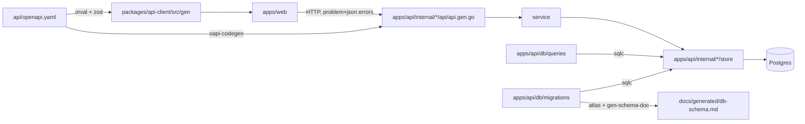
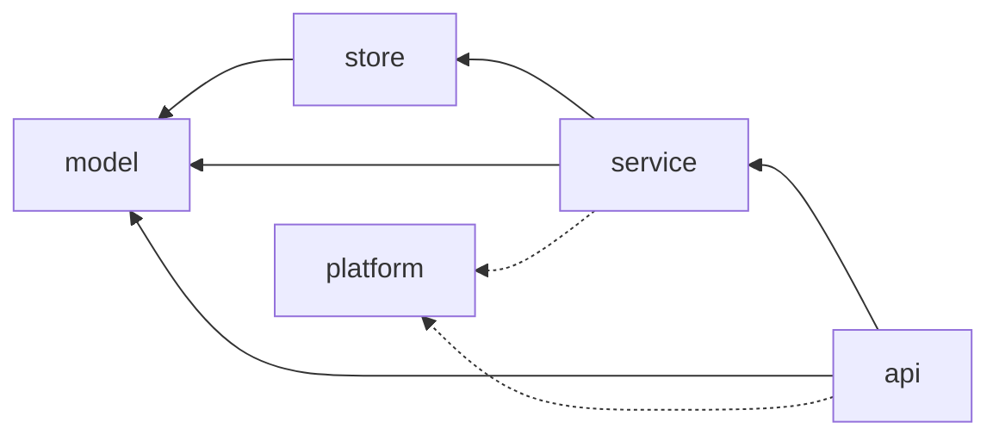

# Architecture

This file is a map, not a manual: where things live, how they connect and which invariants hold. It names
files and symbols so you can find them with grep; it does not link to line numbers, which rot. Rules and
their sensors are in [docs/harness/rules.md](docs/harness/rules.md); decisions in [docs/adr/](docs/adr/README.md).

## Bird's eye view

One contract, two sides. `api/openapi.yaml` is the single source of truth for the HTTP API. `make gen`
turns it into a strict Go server per tag (oapi-codegen) and a typed TanStack Query + zod client (orval).
SQL queries in `apps/api/db/queries/` become Go store code (sqlc) checked against the migrations.

## Codemap

| Path | What it is |
|------|------------|
| `api/openapi.yaml` | OpenAPI 3.1 contract. One tag per domain plus `platform`. Generator markers `harness:domain-*`. |
| `apps/api/cmd/api` | Entry point. `main.go` creates the only root context and wires platform providers; `routes.go` registers every tag's handlers (marker `harness:domain-routes`). |
| `apps/api/internal/platform` | Shared plumbing, imports no domain: `config` (env, fail fast), `logging` (slog JSON with request and trace IDs), `requestid` (`X-Request-Id`), `accesslog` (one line per request), `db` (pgx pool with query spans, `db.Pool`), `auth` (fail-closed stub), `telemetry` (OTel), `problem` (RFC 9457 errors), `health` (`/healthz`); test-only: `approvaltest` (handler tests pin responses, [ADR 0022](docs/adr/0022-approved-api-responses.md)). |
| `apps/api/internal/<domain>` | A business domain, created by `make new-domain`; see [Layers](#layers). None exist yet. |
| `apps/api/db/migrations` | Atlas versioned migrations + `atlas.sum`. Append only. |
| `apps/api/db/queries` | sqlc queries, one file per domain. |
| `apps/api/tools/analyzers` | Custom go/analysis linters (`noctxroot`, `domainiso`), a nested module built into `.bin/golangci-lint-custom`. |
| `apps/api/tools/harness` | The parsing parts of hooks and sensors ([ADR 0012](docs/adr/0012-parsing-sensors-in-go.md)): hook input, `guard-bash`, `check-links`, `fixture-claims`, `approved-check`, `integrity-check`, `rename` (`make rename`); a nested module built into `.bin/harness`. |
| `apps/web` | Vite + React app. Talks to the API only through `@harness-template/api-client`. |
| `packages/api-client` | Generated hooks and zod schemas (`src/gen/`, never edited) + hand-written `src/index.ts` (`problemOf`). |
| `packages/domain` | Pure TypeScript domain logic shared by apps: no React, no browser APIs, no HTTP. |
| `scripts/harness` | Sensors' glue: `run.sh` (uniform failure output with remediation), `gen-check.sh`, `contract-check.sh`, `check-commits.sh`, `check-specs.sh`, `merge-base.sh`, `unchanged.sh` and `affected.sh` (what `make check` skips or scopes in scope `changed`, `HARNESS_SCOPE`, [ADR 0014](docs/adr/0014-make-check-scoped-to-the-change.md)), `timing.sh`, `budgets.txt` and `nfr-report.sh` (latency budgets, timings in `.cache/harness/`, [ADR 0013](docs/adr/0013-harness-nfr-budgets.md)), `determinism.sh`, `hook-bootstrap.sh`, `selftest.sh` + `fixtures/`, `obs-e2e.sh` (`make test-obs`, NFR-O1), `pr-review.sh` (the advisory CI reviewer, [ci.md](docs/harness/ci.md#pr-review)); `coverage.sh` (coverage trend, [ci.md](docs/harness/ci.md#coverage)) and `mutation.sh` with `gremlins.yaml` (mutation score of the week's changes, [ci.md](docs/harness/ci.md#mutation-testing)), reports, not sensors. |
| `scripts/git-hooks` | Git hooks installed by `make setup` (`core.hooksPath`): `pre-commit` runs the secret scan and the cheap per-file sensors on the staged content, `commit-msg` checks Conventional Commits. |
| `scripts/` | `setup-worktree.sh`, `install-tools.sh` (pinned versions in `tool-versions.env`), `new-domain.sh` (its templates in `templates/new-domain/`), `gen-schema-doc.sh`, `obs-query.sh` (`make logs`, `metrics`, `traces`). Shell is code: shellcheck + shfmt (`.shellcheckrc`, `.editorconfig`) and bats tests in `scripts/test/` for these scripts and `.claude/hooks/`. |
| `docs/` | Rules, ADRs, design docs, exec plans, quality grades, generated schema doc. |
| `docs/references/` | `<tool>-llms.txt`: upstream docs for oapi-codegen, sqlc, orval and Atlas taken at the pinned version, header checked against the pin (`make references-pinned`, [ADR 0029](docs/adr/0029-tool-references-follow-the-pin.md)). |
| `specs/` | Product feature specs (`NNN-slug/`: spec, plan, tasks) written with spec-kit; created by the first `/speckit-specify`. |
| `.specify/` | Vendored spec-kit 1.1.3 (scripts, templates; never edited) and our `memory/constitution.md` ([ADR 0011](docs/adr/0011-conventional-commits-and-spec-kit.md)). |
| `.claude/` | Claude Code settings, hooks, subagents and skills. `.github/`: CI gates. |

## Layers

Inside `apps/api/internal/<domain>/`, dependencies point one way:

- `model`: domain types and pure functions. Imports only other `model` code.
- `store`: sqlc-generated persistence. The only place (besides `platform/db`) that imports `pgx`.
- `service`: use cases and business rules. No `net/http`, no SQL. The public face of a domain to other domains.
  Declares the narrow interface over `*store.Queries` it uses, asserted at compile time; tests pass a fake.
- `api`: generated strict server (`api.gen.go`) + `api.go` mapping requests to service calls and errors to
  problem responses. The only domain layer that imports `net/http`.
- Cross-domain: `internal/a/**` may import `internal/b/service` or `internal/b/model`, never `b/store` or `b/api`.

Enforced by go-arch-lint (`apps/api/.go-arch-lint.yml`), depguard (`apps/api/.golangci.yml`) and the
`domainiso` analyzer. The frontend equivalent (dependency-cruiser, ESLint): `packages/domain` is pure,
only `packages/api-client` performs HTTP, and `apps/*` never import each other.

## Request flow

`net/http` server (`cmd/api/main.go`) → request ID (`platform/requestid`) → `otelhttp` server span → access
log (`platform/accesslog`) → auth middleware (`platform/auth`) → `accesslog.Route` (records the matched pattern) → `ServeMux` (`routes.go`) → generated strict
handler (decodes and validates against the spec; invalid input becomes a 400 problem via
`problem.RequestError`) → `api.go` method → `service` → `store` → Postgres. Every function below `cmd`
receives the request's `context.Context`.

## Cross-cutting concerns

- **Errors:** handlers return typed problem responses declared in the spec; unexpected errors become a 500
  problem via `problem.ResponseError`, never a stack trace.
- **Config:** environment only, parsed once in `platform/config`; required values have no defaults.
- **Observability:** slog JSON logs on stdout, and OpenTelemetry traces, metrics and logs, instrumented as
  [ADR 0018](docs/adr/0018-http-and-db-instrumentation.md) records. Each signal has its exporter
  (`OTEL_TRACES_EXPORTER`, `OTEL_METRICS_EXPORTER`, `OTEL_LOGS_EXPORTER`): `none` by default, `otlp` sends it
  over OTLP/HTTP to `OTEL_EXPORTER_OTLP_ENDPOINT` (the worktree's stack, [ADR 0017](docs/adr/0017-per-worktree-observability-stack.md)),
  and traces also take `stdout` ([ADR 0021](docs/adr/0021-telemetry-export-over-otlp-http.md)). The SDK reads
  its own tuning variables; `service.name` is always `api`, whatever `OTEL_SERVICE_NAME` or
  `OTEL_RESOURCE_ATTRIBUTES` say (see ADR 0021). The RED metrics per route are otelhttp's `http.server.request.duration`
  histogram, labelled `http.route`, `http.request.method` and `http.response.status_code`. A route is
  always the template without the method (`/healthz`: log `route`, span and metric `http.route`); only the
  span name is `GET /healthz`. At runtime every
  response carries `X-Request-Id` (an incoming one is kept only if it matches the contract's pattern), but
  the contract declares it only on `/healthz` 200 so far ([TD-16](docs/exec-plans/tech-debt-tracker.md)).
  A problem carries `instance` (`urn:request-id:<id>`) when `platform/problem` writes it or when a handler
  building a spec problem response sets it with `problem.Instance(ctx)` (the `new-domain` scaffold's 503 does). Log lines in a request carry
  `request_id`, `trace_id` and `span_id`; one `request` line per request has method, route template, status
  and `duration_ms`; each SQL query is a child span of the server span.
- **Environments:** each git worktree has its own Postgres container, volume and ports (`.env.local`,
  written by `make setup`), so parallel agents never share state. Its port block also holds an opt-in
  observability stack (`make obs-up`, compose profile `obs`, [ADR 0017](docs/adr/0017-per-worktree-observability-stack.md)):
  `.env.local` points the API's three exporters at it, and `make dev` turns them off if the stack is down
  when `make dev` starts (restart dev after `make obs-up`). Read it through make only:
  `make logs REQUEST_ID=…` (or `QUERY=<LogQL>`), `make traces ID=<trace_id>`, and
  `make metrics QUERY=<PromQL>`, which without `QUERY` fails with an example p95 query; `make obs-down`
  removes it, `make down` removes every container and volume of the worktree. `make test-obs` (in
  `make check-all`) proves one request can be read back this way (NFR-O1). `make dev` always writes each
  run's output to `.tmp/dev/api.log` (JSON lines) and `.tmp/dev/web.log`, the only log without the stack; the
  [query-runtime](.claude/skills/query-runtime/SKILL.md) skill maps runtime questions to these.
  `make e2e` (in `make check-all`) drives the web app in headless Chromium (Playwright,
  `apps/web/e2e/`) against `make dev`, attaching to a running one or starting it (`check-all` always
  starts its own; NFR-B2); see the [drive-app](.claude/skills/drive-app/SKILL.md) skill.
- **Generated code** is committed; `make gen-check` fails if it is stale or hand-edited.

## Invariants worth knowing

- Nothing below `cmd/` calls `context.Background()`.
- `platform` never imports a domain; a domain never imports another domain's `store` or `api`.
- Every error response is `application/problem+json`; every operation has an `operationId` and exactly one tag.
- Breaking contract changes and destructive migrations fail CI unless a human approves them.
